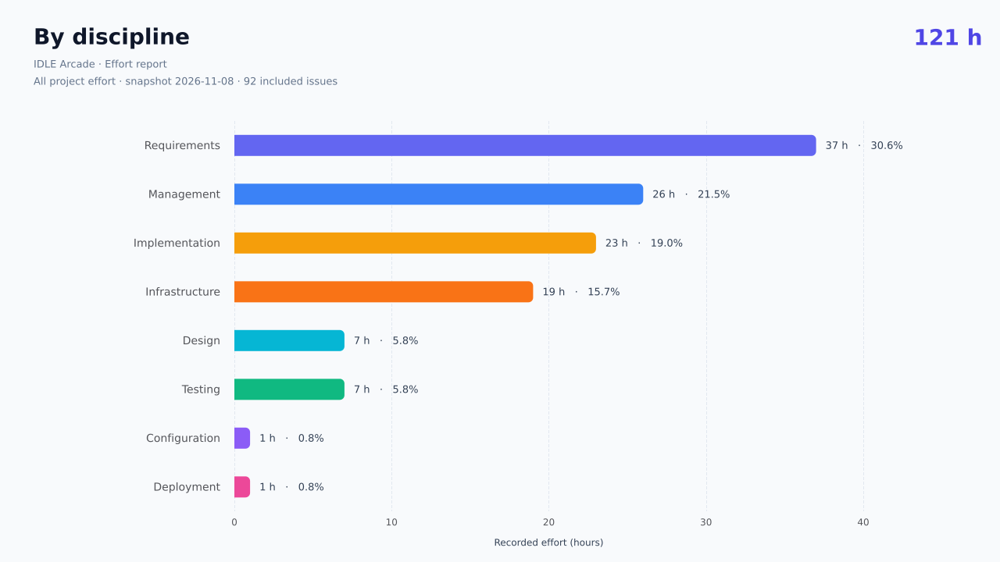
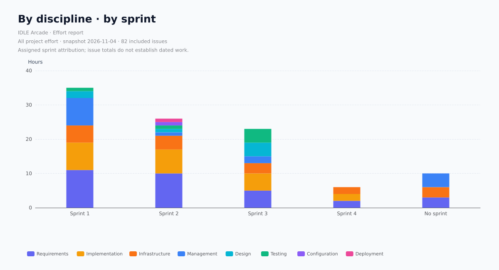
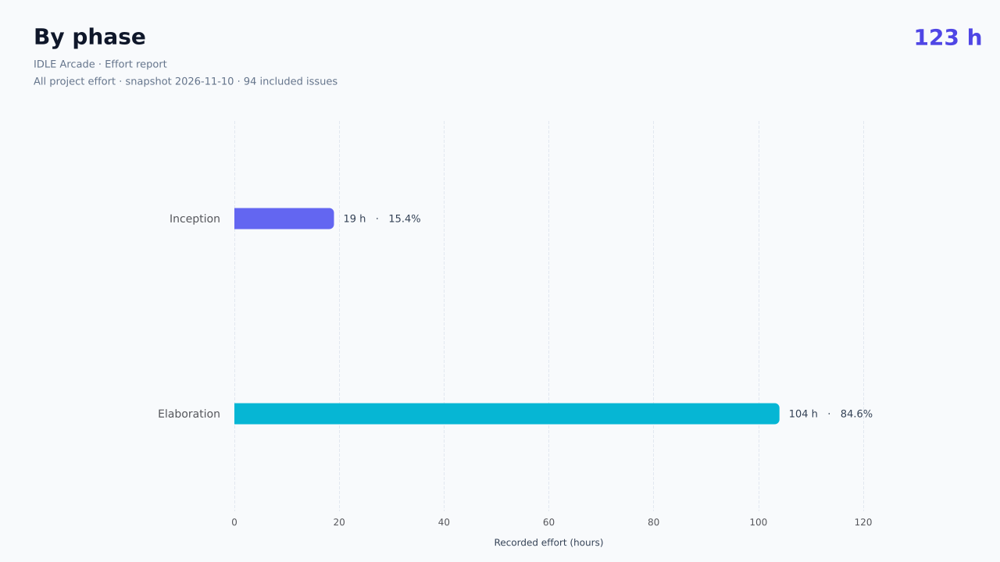
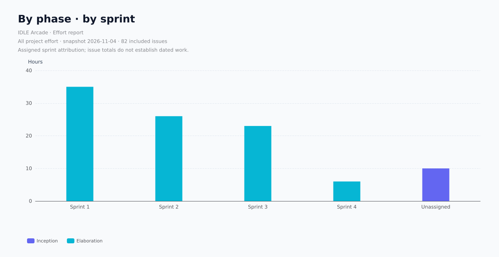
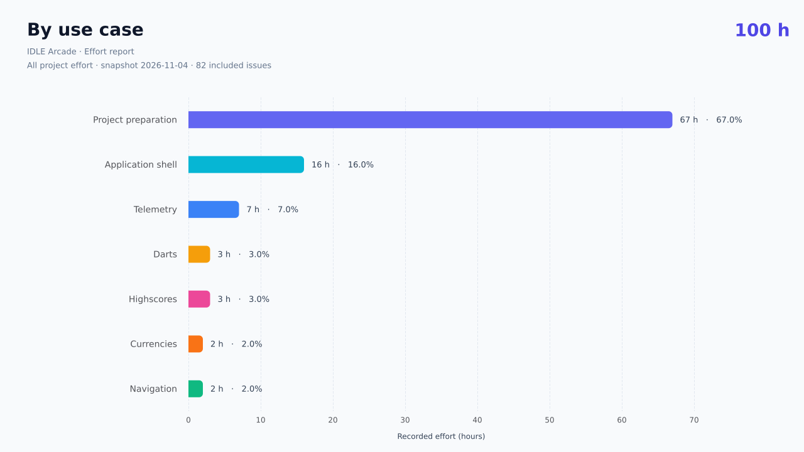
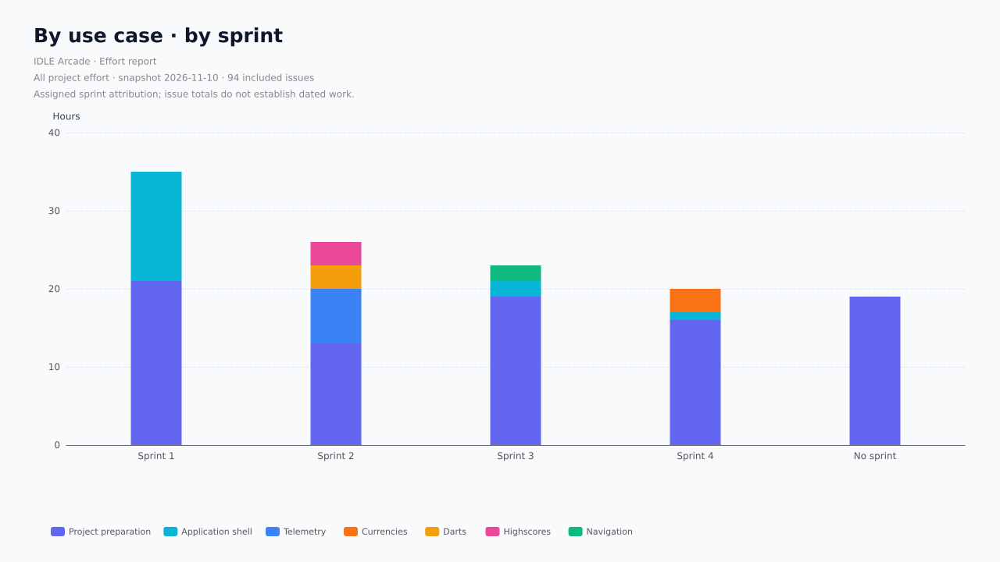
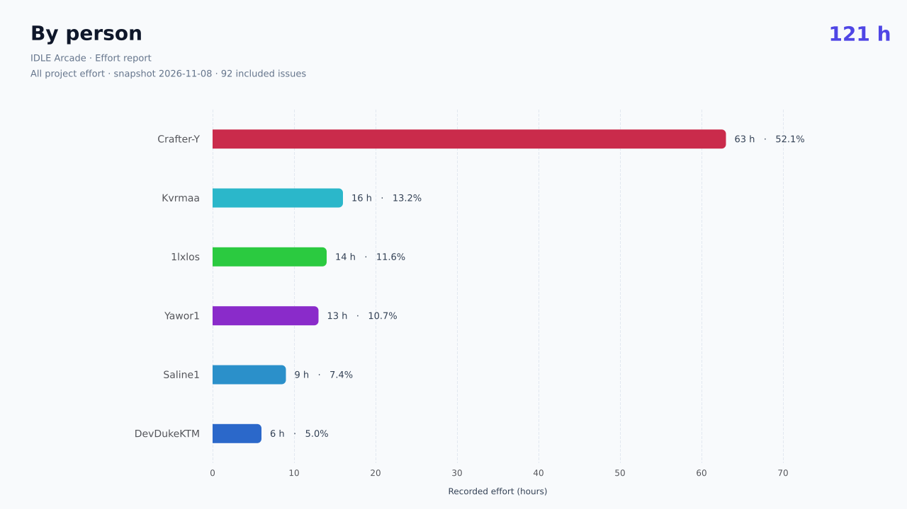
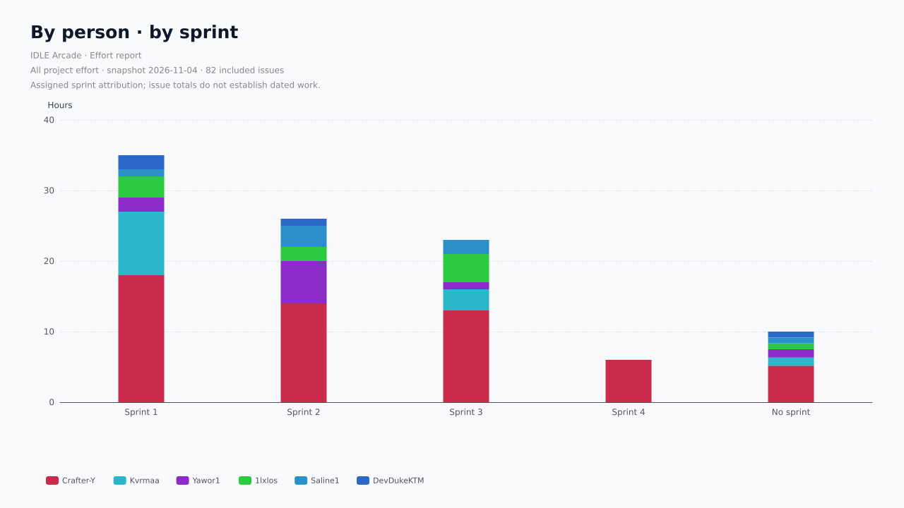

# IDLE Arcade · Effort report

All project effort · **100.00 recorded hours** · 82 included leaf issues.

Source: [IDLE Arcade](https://github.com/orgs/idle-arcade/projects/1). Snapshot fetch window: 2026-11-04T19:56:52.014Z to 2026-11-04T19:56:55.190Z. Source SHA-256: `9585f4a458d67faf56b0dc1013931e6a6d5adef1bac440000d85f8124ea069ca`.

## By discipline

| Category | Hours | Share | Issues |
| --- | ---: | ---: | ---: |
| requirements | 31.00 | 31.0% | 29 |
| implementation | 22.00 | 22.0% | 15 |
| infrastructure | 17.00 | 17.0% | 8 |
| management | 15.00 | 15.0% | 17 |
| design | 7.00 | 7.0% | 4 |
| testing | 6.00 | 6.0% | 7 |
| configuration | 1.00 | 1.0% | 1 |
| deployment | 1.00 | 1.0% | 1 |

## By phase

| Category | Hours | Share | Issues |
| --- | ---: | ---: | ---: |
| inception | 10.00 | 10.0% | 17 |
| elaboration | 90.00 | 90.0% | 65 |

## By use case

| Category | Hours | Share | Issues |
| --- | ---: | ---: | ---: |
| project-preparation | 67.00 | 67.0% | 60 |
| application-shell | 16.00 | 16.0% | 8 |
| telemetry | 7.00 | 7.0% | 3 |
| darts | 3.00 | 3.0% | 2 |
| highscores | 3.00 | 3.0% | 4 |
| currencies | 2.00 | 2.0% | 3 |
| navigation | 2.00 | 2.0% | 2 |

## By person

| Category | Hours | Share | Issues |
| --- | ---: | ---: | ---: |
| Crafter-Y | 56.17 | 56.2% | 37 |
| Kvrmaa | 13.17 | 13.2% | 13 |
| Yawor1 | 10.17 | 10.2% | 11 |
| 1lxlos | 9.83 | 9.8% | 10 |
| Saline1 | 6.83 | 6.8% | 6 |
| DevDukeKTM | 3.83 | 3.8% | 5 |

## Accounting and coverage

Only issues on the project board count, including archived items and open issues. Parent totals are excluded even when their children are outside the board or have missing data. One issue, one assignee, one label per category dimension. Invalid records are skipped for every dimension; percentages therefore describe valid included recorded effort, not all actual work. Zero hours are valid; absent hours are not zero. Person means assigned person (GitHub display name, login fallback), as agreed by the team.

The views describe the same hours and must not be added together. Every dimension reconciles to 100.00 h. Sprint charts use current sprint attribution, not dated work entries. The source is current at the fetch window; it does not reconstruct historical field values. Removed/deleted items are unavailable, and inaccessible content is skipped with diagnostics.

## Data quality

125 board items fetched (0 archived); 82 valid leaf issues included in this scope.

- parent-rollup: 23
- invalid-hours: 19
- invalid-assignee: 16

See [quality.json](quality.json) for issue-level reasons and [effort.csv](effort.csv) for counted records. Diagnostics are also printed to the console. Fix sources and rerun.
