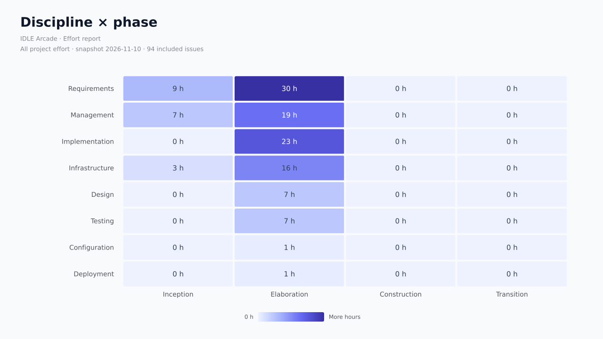
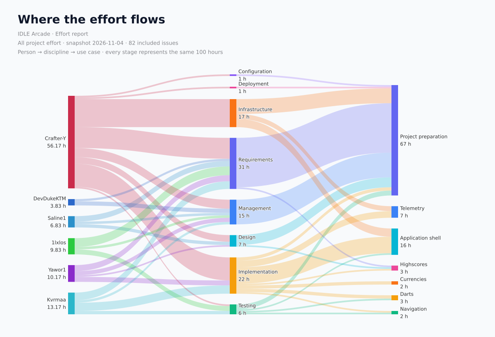
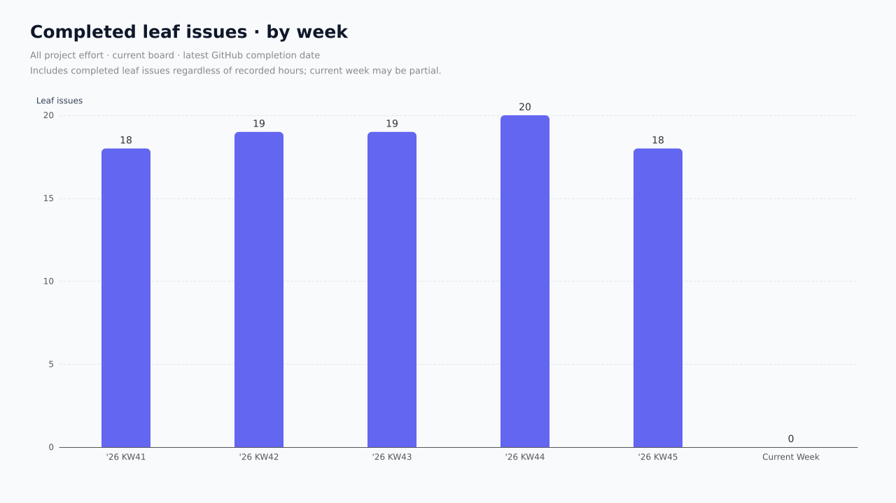

# IDLE Arcade · Effort report

All project effort · **123.00 recorded hours** · 94 included leaf issues.

Source: [IDLE Arcade](https://github.com/orgs/idle-arcade/projects/1). Snapshot fetch window: 2026-11-10T04:05:44.543Z to 2026-11-10T04:05:47.668Z. Source SHA-256: `fd7b37998d1a8203b1bf4a7fbc5d40b8b32f0534753c78123241bf902b6fb73a`.

## By discipline

| Category | Hours | Share | Issues |
| --- | ---: | ---: | ---: |
| requirements | 39.00 | 31.7% | 31 |
| management | 26.00 | 21.1% | 24 |
| implementation | 23.00 | 18.7% | 16 |
| infrastructure | 19.00 | 15.4% | 9 |
| design | 7.00 | 5.7% | 4 |
| testing | 7.00 | 5.7% | 8 |
| configuration | 1.00 | 0.8% | 1 |
| deployment | 1.00 | 0.8% | 1 |

## By phase

| Category | Hours | Share | Issues |
| --- | ---: | ---: | ---: |
| inception | 19.00 | 15.4% | 17 |
| elaboration | 104.00 | 84.6% | 77 |

## By use case

| Category | Hours | Share | Issues |
| --- | ---: | ---: | ---: |
| project-preparation | 88.00 | 71.5% | 70 |
| application-shell | 17.00 | 13.8% | 9 |
| telemetry | 7.00 | 5.7% | 3 |
| currencies | 3.00 | 2.4% | 4 |
| darts | 3.00 | 2.4% | 2 |
| highscores | 3.00 | 2.4% | 4 |
| navigation | 2.00 | 1.6% | 2 |

## By person

| Category | Hours | Share | Issues |
| --- | ---: | ---: | ---: |
| Crafter-Y | 63.00 | 51.2% | 41 |
| Kvrmaa | 16.00 | 13.0% | 14 |
| 1lxlos | 15.00 | 12.2% | 13 |
| Yawor1 | 13.00 | 10.6% | 12 |
| Saline1 | 9.00 | 7.3% | 7 |
| DevDukeKTM | 7.00 | 5.7% | 7 |

## Discipline × phase

## Effort flow

Each stage represents the same recorded hours. Links aggregate adjacent categories.

## Completed leaf issues by week

Counts currently completed leaf issues on the current board by their latest GitHub closing date, including issues without recorded hours. Not-planned closures and parents are excluded. Each issue counts once; reopened issues are absent until completed again, then move to their latest closing week. This is a current-cohort completion distribution, not a reconstruction of historical board scope. Weeks run Tuesday–Monday in Europe/Berlin and use the ISO calendar-week number of their starting Tuesday; the current week may be partial.

## Native burn-up

[View the GitHub-provided historical burn-up](https://github.com/orgs/idle-arcade/projects/1/insights?period=max). No local story-history snapshots or reconstructed burn-up are used. GitHub Insights has its own scope rules, including exclusion of archived/deleted items.

[Repository maps and Gource trial](../../repository/README.md)

## Accounting and coverage

Only issues on the project board count, including archived items and open issues. Parent totals are excluded even when their children are outside the board or have missing data. One issue, one assignee, one label per category dimension. Invalid records are skipped for every dimension; percentages therefore describe valid included recorded effort, not all actual work. Zero hours are valid; absent hours are not zero. Person means assigned person (GitHub display name, login fallback), as agreed by the team.

The views describe the same hours and must not be added together. Every dimension reconciles to 123.00 h. Sprint charts use current sprint attribution, not dated work entries. The source is current at the fetch window; it does not reconstruct historical field values. Removed/deleted items are unavailable, and inaccessible content is skipped with diagnostics.

## Data quality

132 board items fetched (0 archived); 94 valid leaf issues included in this scope.

- parent-rollup: 24
- invalid-hours: 12
- invalid-assignee: 14

See [quality.json](quality.json) for issue-level reasons and [effort.csv](effort.csv) for counted records. Diagnostics are also printed to the console. Fix sources and rerun.
