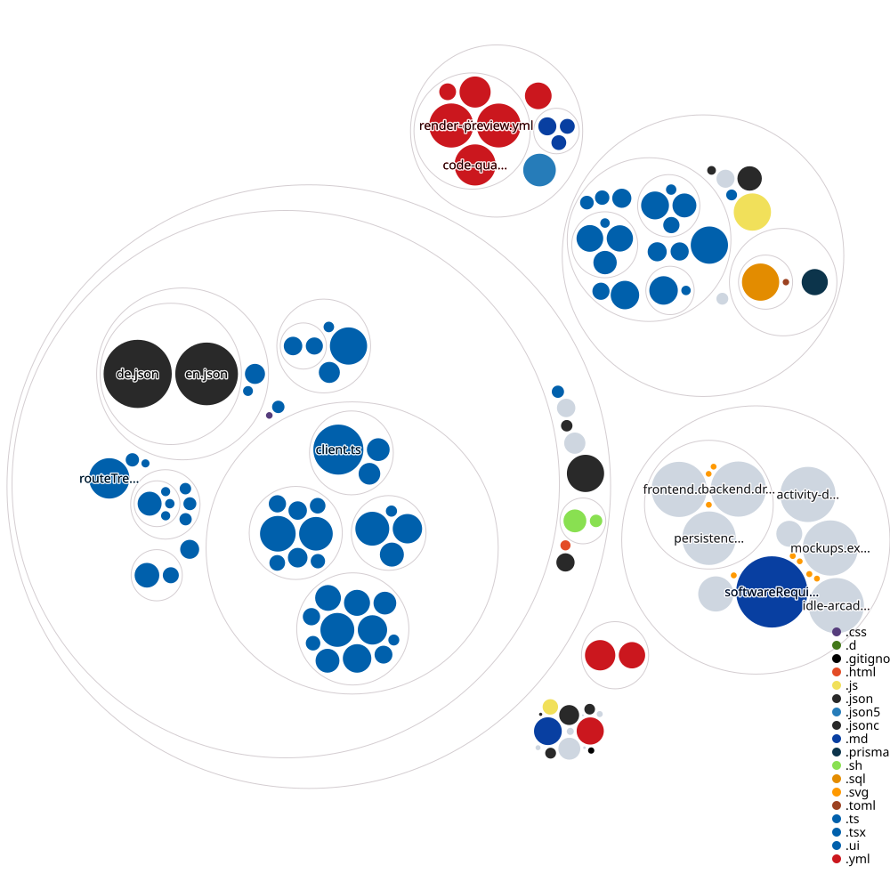
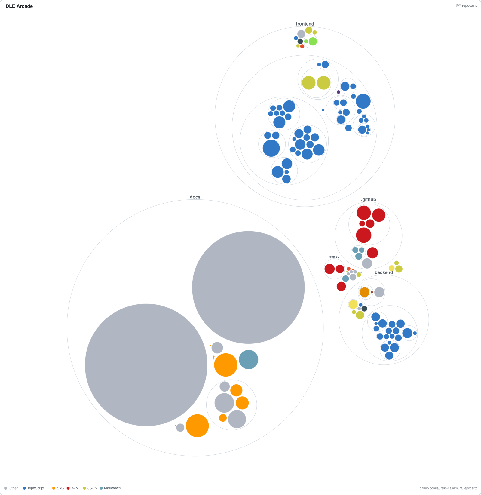
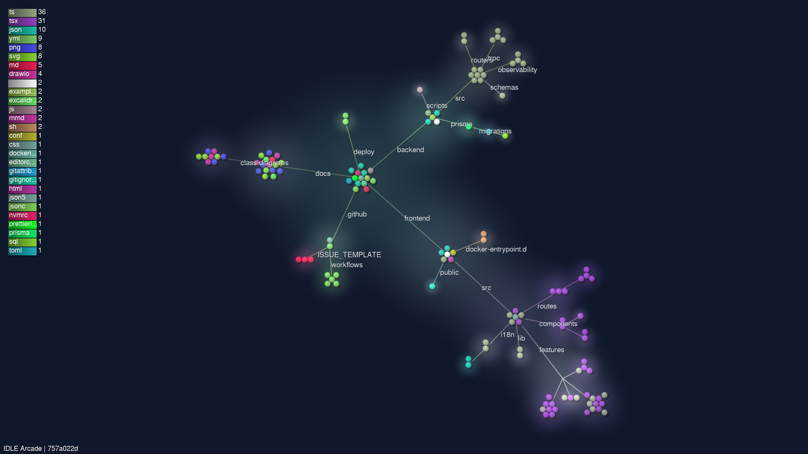

# IDLE Arcade repository maps

Source: [idle-arcade/game at 757a022d](https://github.com/idle-arcade/game/commit/757a022d9028b7b7741e4e0a1d5d5a45f5d3b0fe). These images show file/folder structure, not runtime dependencies or software architecture. Generated artifacts stay in the charts repository; the game checkout is read-only.

## Repo Visualizer

[PNG](repo-visualizer.png) · [Existing upstream renderer](https://github.com/githubocto/repo-visualizer). The upstream action is archived and pinned to a reviewed commit; its automatic push is disabled. Files are grouped by directory and colored by type. Export margins and a white background keep the upstream legend visible in SVG/PNG; the layout is unchanged. Lockfiles, binary assets, drawing source files and build/dependency folders are excluded to keep source structure readable.

## Repocarto

[PNG](repocarto.png) · [Existing upstream renderer](https://github.com/aurelio-nakamura/repocarto). Nested circles represent directories; file area represents lines of code and color represents language. The scan uses tracked source files with build/dependency folders, lockfiles, drawing source files and binary assets omitted in a temporary visualization checkout. Both the action and npm package are pinned.

## Gource still (experimental)

Real Git history rendered by Gource, retaining its final frame as a PNG. Source commit: [757a022d](https://github.com/idle-arcade/game/commit/757a022d9028b7b7741e4e0a1d5d5a45f5d3b0fe). The still keeps idle files visible and hides people/motion so directory structure remains the focus. This trial is regenerated only when manual dispatch enables **gource_preview**; it can therefore have an older source commit than the maps above. No video is stored.
